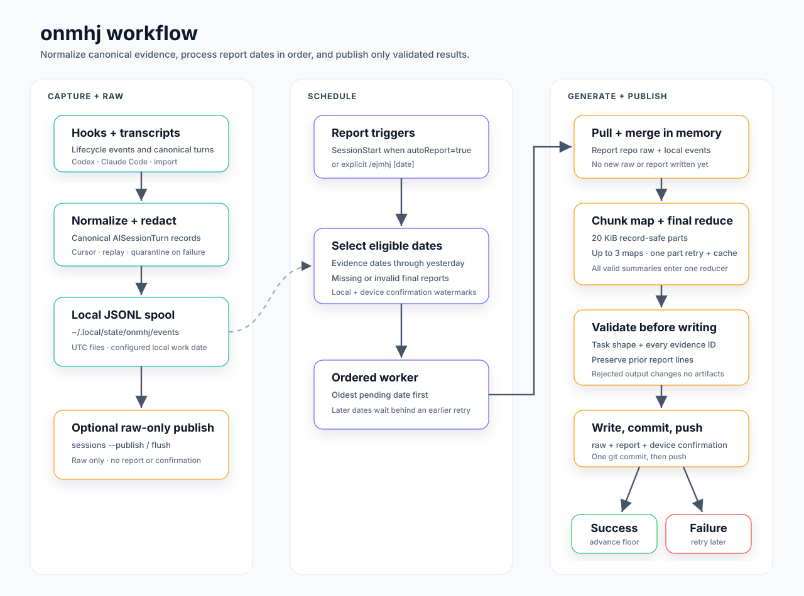

# 🤔 onmhj

AI-session worklog capture plugin for Codex / Claude Code / DeepSeek Harness.

[Korean README](./docs/README.ko.md) · [Installation](./docs/installation.md) · [Internals](./docs/internals.md)

## What it does

- Daily reports without notes: work you do with AI agents becomes a daily work report automatically, so "what did I do yesterday?" has an answer.
- One record per date: work from Codex, Claude Code, and DeepSeek Harness, across multiple computers, is merged into a single record.
- Your own git repo: records and reports accumulate in a git repo you own, so you can search them and keep their history.
- The login you already use: reports are generated with your Claude Code or Codex login, with no separate API key. You can also use an OpenAI-compatible API or a local model.
- Automatic catch-up: supports automatically catching up missed days in the background.

Hooks record events locally; `flush` and report jobs merge them into the report repo and write `reports/YYYY-MM-DD.md`.



## Install

See [docs/installation.md](./docs/installation.md).

Agent handoff prompt:

```txt
Read docs/installation.md and install onmhj for this agent platform (Codex or Claude Code).
Use /path/to/onmhj-storage as the report repo.
After installing, run the platform smoke test and generate one final report with its documented `ejmhj` command.
```

## Quick Start

After install, register the report repo:

```sh
node bin/onmhj.js register /path/to/worklog-git-repo --timezone=Asia/Seoul
```

Set the device, owner, report language, and auth policy:

```sh
node bin/onmhj.js config \
  --device-id=macbook-pro \
  --owner-name="Your Name" \
  --owner-email=you@example.com \
  --report-lang=ko \
  --report-auth=agent \
  --report-agent=auto \
  --report-agent-effort=medium \
  --report-timeout-minutes=15
```

Agent mode defaults to `sonnet` for Claude and `gpt-5.6-terra` for Codex. Use `--report-agent-model=MODEL` to override the selected provider's model.

Check capture status:

```sh
node bin/onmhj.js status
```

Manual flush remains available:

```sh
node bin/onmhj.js flush 2026-07-09
node bin/onmhj.js flush 2026-07-09 --no-push
```

## Commands

| Command | Purpose |
| --- | --- |
| `onmhj register <repo>` | Set the external report repo. |
| `onmhj config ...` | Update timezone, device id, owner, automatic-report, language, auth, and API settings. |
| `onmhj status` | Show config, local event count, confirmed floor, and job counts. |
| `onmhj flush [date]` | Merge events and publish raw evidence without confirming the date. |
| `onmhj ejmhj [date]` | Publish raw evidence and the final report for yesterday or the specified work date. |
| `onmhj inject --text=...` | Add one normalized manual event. |
| `onmhj import <events.jsonl>` | Import normalized events or OpenAI-compatible request/response captures. |
| `onmhj sessions [--publish]` | Incrementally scan Codex, Claude, and DeepSeek Harness transcripts; optionally publish all raw dates in one commit. |
| `onmhj catchup` | Scan transcripts and run due report jobs without a lifecycle hook. |
| `onmhj schedule install\|uninstall\|status` | Register `catchup` as an hourly OS task (launchd, systemd user timer, or Task Scheduler). |
| `onmhj worker` | Process pending report jobs in the background. |
| `onmhj selftest` | Run the isolated built-in verification without changing the active user config. |

Plugin commands delegate to the same CLI: Codex uses `/onmhj ...` and `/ejmhj [date]`; Claude Code uses `/onmhj:onmhj ...` and `/onmhj:ejmhj [date]`.

## Backfill

```sh
node bin/onmhj.js inject --date=2026-07-08 --cwd=/path/to/repo --source=manual --source-id=manual-2026-07-08-1 --text="Work summary"
node bin/onmhj.js import /tmp/onmhj-backfill.jsonl
```

`inject` adds one manual event; `import` loads a normalized or OpenAI-compatible JSONL file. Formats and rules: [Internals](./docs/internals.md#backfill).

## Data and Safety

Local config and events live under `~/.config/onmhj` and `~/.local/state/onmhj`. The report repo holds `raw/ai-sessions/`, `reports/`, and `state/devices/`.

- Hooks only record events locally.
- Git commit and push happen only during `sessions --publish`, `flush`, or report jobs.
- Prompts and final answers are stored in full after best-effort secret redaction; reasoning and tool arguments are not stored.
- Reports are generated by an isolated, non-interactive agent that treats evidence as untrusted data.
- A report that fails validation is never published.

Full storage layout, confirmation rules, and safeguards: [Internals](./docs/internals.md).
