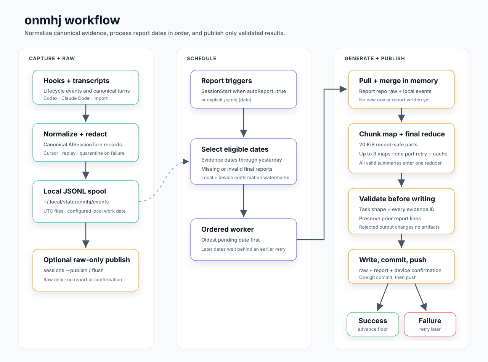

# 🤔 onmhj

Codex / Claude Code / DeepSeek Harness용 AI 세션 작업 로그 캡처 플러그인

[English README](../README.md) · [Installation](./installation.md) · [Internals](./internals.ko.md)

## 할 수 있는 일

- 메모 없는 일일 보고서: AI agent와 한 작업이 자동으로 날짜별 업무 보고서가 되어, "어제 뭐 했지?"에 바로 답할 수 있습니다.
- 날짜별 하나의 기록: Codex, Claude Code, DeepSeek Harness의 작업을 여러 컴퓨터에 걸쳐 하나의 기록으로 병합합니다.
- 내 git repo에 보관: 기록과 보고서가 내가 소유한 git repo에 쌓여 직접 검색하고 이력을 유지할 수 있습니다.
- 쓰던 로그인 그대로: 이미 쓰는 Claude Code 또는 Codex 로그인으로 보고서를 만들어 별도 API key가 필요 없습니다. OpenAI 호환 API나 로컬 모델을 활용하는 것도 가능합니다.
- 자동 catch-up: 놓친 날짜를 백그라운드에서 자동으로 따라잡는 기능을 지원합니다.

hook이 이벤트를 로컬에 기록하면, `flush`와 report job이 이를 report repo에 병합하고 `reports/YYYY-MM-DD.md`를 작성합니다.



## Install

[docs/installation.md](./installation.md)를 따릅니다.

Agent handoff prompt:

```txt
Read docs/installation.md and install onmhj for this agent platform (Codex or Claude Code).
Use /path/to/onmhj-storage as the report repo.
After installing, run the platform smoke test and generate one final report with its documented `ejmhj` command.
```

## Quick Start

설치 후 report repo를 등록합니다:

```sh
node bin/onmhj.js register /path/to/worklog-git-repo --timezone=Asia/Seoul
```

device, owner, report language, auth 정책을 설정합니다:

```sh
node bin/onmhj.js config \
  --device-id=macbook-pro \
  --owner-name="Your Name" \
  --owner-email=you@example.com \
  --report-lang=ko \
  --report-auth=agent \
  --report-agent=auto \
  --report-agent-effort=medium \
  --report-timeout-minutes=15
```

Agent mode 기본 모델은 Claude `sonnet`, Codex `gpt-5.6-terra`입니다. 선택한 provider의 모델을 바꾸려면 `--report-agent-model=MODEL`을 사용합니다.

캡처 상태 확인:

```sh
node bin/onmhj.js status
```

수동 flush:

```sh
node bin/onmhj.js flush 2026-07-09
node bin/onmhj.js flush 2026-07-09 --no-push
```

## Commands

| Command | Purpose |
| --- | --- |
| `onmhj register <repo>` | 외부 report repo 설정 |
| `onmhj config ...` | timezone, device id, owner, 자동 report, language, auth, API 설정 변경 |
| `onmhj status` | config, local event 수, confirmed floor, job 수 확인 |
| `onmhj flush [date]` | event 병합과 raw 근거 발행. 날짜 확정 안 함 |
| `onmhj ejmhj [date]` | 어제 또는 지정 작업일의 raw 근거와 최종보고서 발행 |
| `onmhj inject --text=...` | 수동 이벤트 1건 추가 |
| `onmhj import <events.jsonl>` | 정규화 event 또는 OpenAI-compatible request/response capture import |
| `onmhj sessions [--publish]` | Codex·Claude·DeepSeek Harness transcript 증분 수집 및 선택적 raw-only 단일 커밋 발행 |
| `onmhj catchup` | lifecycle hook 없이 transcript 수집과 기한 도래 report job 실행 |
| `onmhj schedule install\|uninstall\|status` | `catchup`을 OS 주기 작업(launchd, systemd user timer, 작업 스케줄러)으로 1시간마다 실행 등록 |
| `onmhj worker` | pending report job 처리 |
| `onmhj selftest` | 현재 사용자 설정을 바꾸지 않고 격리된 내장 검증 실행 |

plugin command는 같은 CLI로 위임합니다. Codex는 `/onmhj ...`, `/ejmhj [date]`를 사용하고 Claude Code는 `/onmhj:onmhj ...`, `/onmhj:ejmhj [date]`를 사용합니다.

## Backfill

```sh
node bin/onmhj.js inject --date=2026-07-08 --cwd=/path/to/repo --source=manual --source-id=manual-2026-07-08-1 --text="작업 요약"
node bin/onmhj.js import /tmp/onmhj-backfill.jsonl
```

`inject`는 수동 이벤트 1건을 추가하고, `import`는 정규화된 JSONL이나 OpenAI 호환 capture JSONL을 불러옵니다. 형식과 규칙은 [Internals](./internals.ko.md#backfill)를 참고하세요.

## 데이터와 안전

로컬 설정과 이벤트는 `~/.config/onmhj`와 `~/.local/state/onmhj`에 저장됩니다. report repo에는 `raw/ai-sessions/`, `reports/`, `state/devices/`가 쌓입니다.

- hook은 이벤트를 로컬에만 기록합니다.
- git commit과 push는 `sessions --publish`, `flush`, report job 실행 중에만 일어납니다.
- prompt와 최종 answer는 best-effort 비밀 정보 redaction 후 전체를 저장하며, reasoning과 tool argument는 저장하지 않습니다.
- 보고서는 격리된 non-interactive agent가 생성하며 evidence를 신뢰할 수 없는 데이터로 취급합니다.
- 검증을 통과하지 못한 보고서는 발행하지 않습니다.

전체 저장 구조, 확정 규칙, 안전 장치는 [Internals](./internals.ko.md)를 참고하세요.
